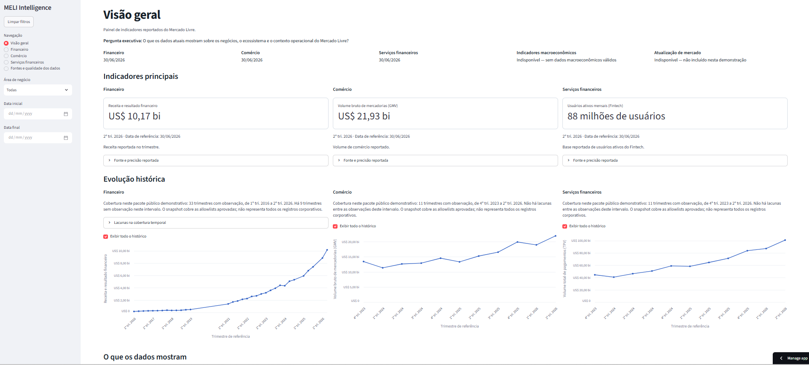
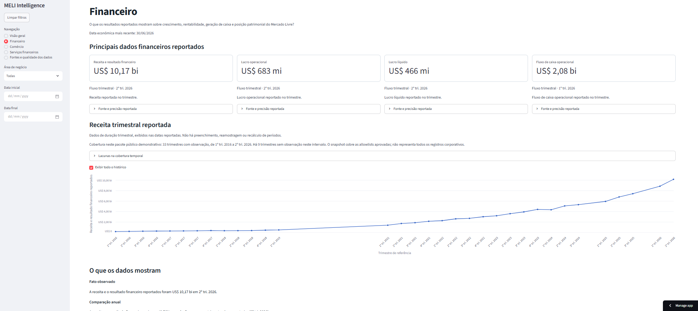
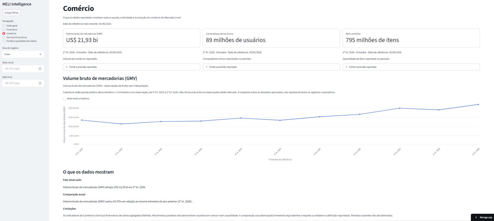
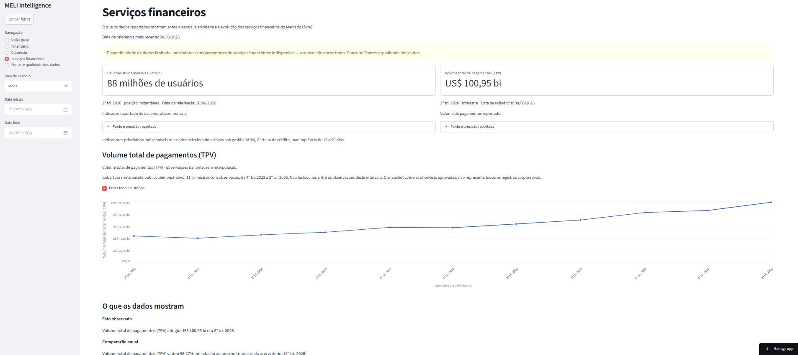
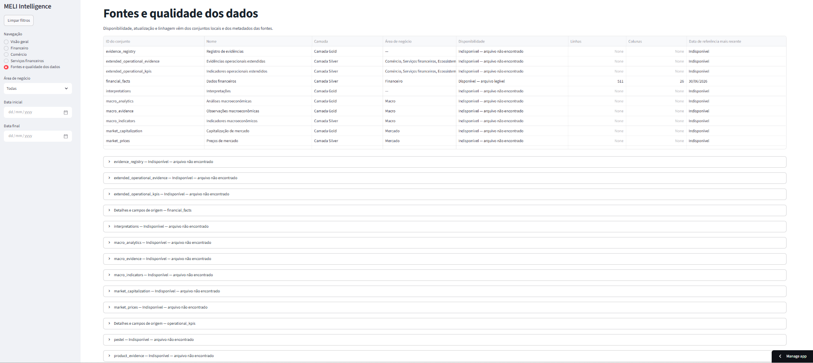
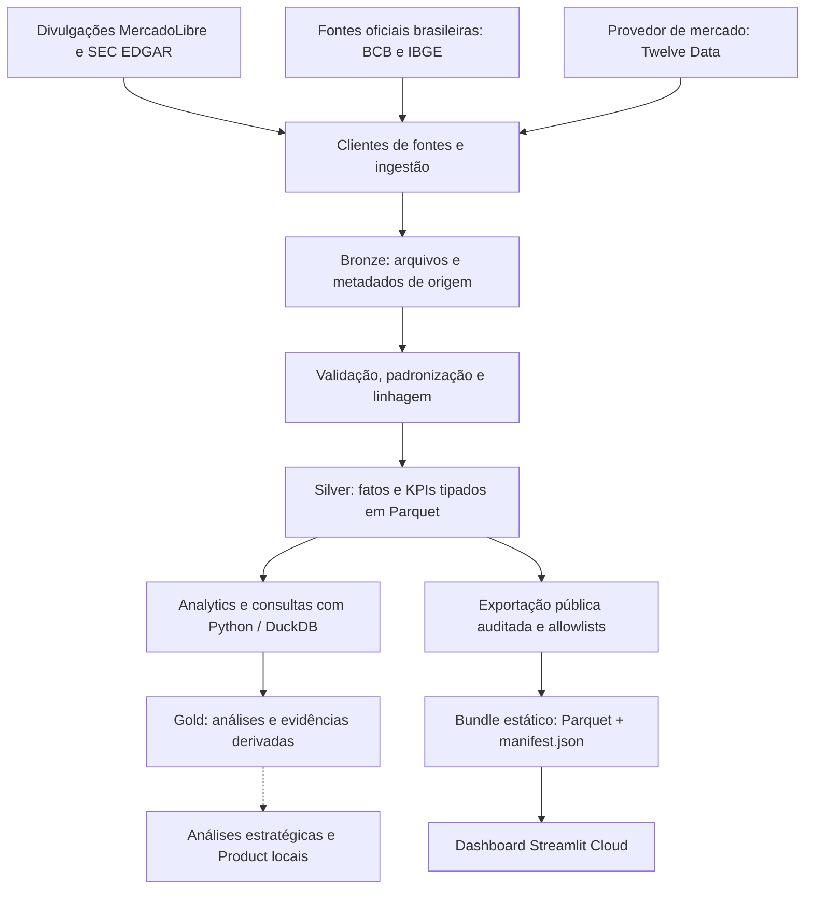

<div align="center">

# MELI Intelligence

### Inteligência de negócios, engenharia de dados e análise estratégica do ecossistema Mercado Livre

**Um case de dados que transforma divulgações corporativas em indicadores comparáveis, narrativas executivas e evidências rastreáveis.**

[](https://www.python.org/)
[](https://streamlit.io/)


**[🚀 Acessar o dashboard](https://meli-intelligence-jkgyb7xmdvhyhhkq3gtcwu.streamlit.app/)** · **[💻 Explorar o repositório](https://github.com/Emanoelgenez/meli-intelligence)** · **[📚 Consultar a metodologia](docs/methodology/)**

*Projeto independente de caráter acadêmico e de portfólio; sem afiliação, patrocínio ou endosso do Mercado Livre/MercadoLibre ou da SEC.*

</div>

---

## Visão do projeto

O **MELI Intelligence** é uma plataforma analítica desenvolvida no contexto de um **MBA / Tech Challenge**, usando o ecossistema do **MercadoLibre, Inc.** — incluindo as frentes de comércio eletrônico e serviços financeiros — como objeto de estudo.

Seu propósito é responder a uma questão de negócio:

> **Como transformar dados públicos, dispersos e com diferentes definições em uma leitura executiva confiável sobre crescimento, desempenho operacional e evolução de um ecossistema digital?**

Em vez de apresentar números isolados, o projeto conecta **fonte, métrica, período econômico, unidade, histórico, comparabilidade e interpretação**, permitindo identificar o que é evidência observada, o que é análise e o que continua indisponível.

| Desafio | Abordagem | Entrega verificável |
| :--- | :--- | :--- |
| Divulgações distribuídas entre demonstrações e releases | Pipeline de padronização e dados tabulares com proveniência | Base analítica auditável em Parquet |
| Métricas de naturezas e períodos distintos | Contratos de dados, filtros e regras de comparação | Séries trimestrais e YoY calculado somente quando válido |
| Falta de uma leitura unificada para stakeholders | Storytelling por domínio de negócio | Dashboard executivo em português, publicado no Streamlit Cloud |
| Risco de dados ausentes serem interpretados como zero | Verificações de qualidade e estados explícitos de indisponibilidade | Transparência sobre cobertura, lacunas e limitações |
| Diferenças entre o ambiente local e o ambiente publicado | Testes de instalação, regressão e homologação em duas etapas | Processo de deploy reproduzível e mais confiável |

### Demonstração

<a href="https://meli-intelligence-jkgyb7xmdvhyhhkq3gtcwu.streamlit.app/">
  
</a>

<p align="center"><sub>Visão geral da versão pública homologada. Clique na imagem para abrir a demonstração.</sub></p>

> [!IMPORTANT]
> O aplicativo público é um **recorte estático e auditado**, com data econômica de referência até **30/06/2026**. As métricas financeiras corporativas referem-se à **MercadoLibre, Inc. em base consolidada**, não exclusivamente às operações brasileiras. Não se trata de um painel em tempo real.

---

## Resultados entregues

### Indicadores e cobertura histórica

A versão pública ampliada, homologada em **15/10/2026**, apresenta:

| Indicador | Resultado exibido em 2026T2 | Cobertura disponibilizada |
| :--- | ---: | :--- |
| Receita e resultado financeiro reportados | **US$ 10,17 bi** | **33 trimestres observados** entre 2016T1 e 2026T2; lacunas explicitadas |
| Volume bruto de mercadorias — **GMV** | **US$ 21,93 bi** | **11 trimestres** entre 2023T4 e 2026T2 |
| Volume total de pagamentos — **TPV** | **US$ 100,95 bi** | **11 trimestres** entre 2023T4 e 2026T2 |
| Usuários ativos mensais — Fintech (**MAU**) | **88 milhões** | **11 observações** no recorte operacional |
| Compradores ativos únicos | **89 milhões** | Dado operacional reportado no período |
| Itens vendidos | **795 milhões** | Dado operacional reportado no período |

**Comparação anual para 2026T2 versus 2025T2**, conforme regras de comparabilidade do projeto:

| Métrica | Variação YoY |
| :--- | ---: |
| Receita e resultado financeiro reportados | **+49,76%** |
| GMV | **+43,70%** |
| TPV | **+56,27%** |

O pacote demonstrativo contém **511 registros financeiros** e **55 registros operacionais**. Essas quantidades representam **linhas de fatos aprovados**, não o número de empresas, clientes ou trimestres de cada métrica.

**O que esses resultados significam:** os dados oferecem uma visão factual da trajetória reportada da companhia e de suas operações. Não constituem, por si só, prova de causalidade, recomendação de investimento, mensuração de retenção ou identificação de usuários comuns entre comércio e Fintech.

---

## Produto: conheça as cinco páginas

| Página | Pergunta que ajuda a responder | Principais elementos |
| :--- | :--- | :--- |
| **Visão geral** | Como evoluem os indicadores centrais do ecossistema? | Receita, GMV, usuários Fintech, três gráficos e narrativa executiva |
| **Financeiro** | Como se comportam receita, rentabilidade e geração de caixa? | Receita, lucro operacional, lucro líquido, fluxo de caixa operacional e série histórica |
| **Comércio** | Qual é a evolução da atividade de marketplace? | GMV, compradores ativos únicos, itens vendidos e YoY |
| **Serviços financeiros** | Como evoluem a escala e o volume transacionado da Fintech? | MAU, TPV, evolução trimestral e YoY |
| **Fontes e qualidade dos dados** | Quais bases sustentam a análise e quais não estão disponíveis? | Catálogo, estados de saúde, contagens, datas, linhagem e limitações |

### Galeria do dashboard

<table>
<tr>
<td width="50%" align="center">
  <a href="docs/images/dashboard-financeiro.png"></a>
  <br><b>01 · Financeiro</b><br><sub>Desempenho, geração de caixa e histórico com lacunas.</sub>
</td>
<td width="50%" align="center">
  <a href="docs/images/dashboard-comercio.png"></a>
  <br><b>02 · Comércio</b><br><sub>Escala do marketplace e evolução do GMV.</sub>
</td>
</tr>
<tr>
<td width="50%" align="center">
  <a href="docs/images/dashboard-servicos-financeiros.png"></a>
  <br><b>03 · Serviços financeiros</b><br><sub>Base ativa Fintech e volume de pagamentos.</sub>
</td>
<td width="50%" align="center">
  <a href="docs/images/dashboard-fontes-qualidade.png"></a>
  <br><b>04 · Fontes e qualidade</b><br><sub>Saúde, cobertura e rastreabilidade dos conjuntos de dados.</sub>
</td>
</tr>
</table>

**Recursos de navegação:** seleção de domínio, filtros de datas, opção **“Exibir todo o histórico”**, limpeza de filtros e detalhamento da fonte e precisão reportada. O recorte visível varia de acordo com a página, a métrica e a cobertura efetivamente disponível.

---

## Arquitetura de dados

A arquitetura adota uma separação por responsabilidades inspirada em **Bronze → Silver → Gold**, de modo que a aquisição das fontes não se confunda com a camada de visualização.



> **Importante:** o diagrama descreve as capacidades do repositório. **A publicação pública utiliza somente a ramificação SEC/Company validada e o bundle estático.** Bases brasileiras, cotações de mercado e análises estratégicas locais não são automaticamente distribuídas no Streamlit.

### Responsabilidades das camadas

| Camada | Responsabilidade | Exemplos no repositório |
| :--- | :--- | :--- |
| **Sources / Pipelines** | Coleta e processamento por fonte, quando executados explicitamente | `src/meli_intelligence/sources/`, `pipelines/` |
| **Bronze** | Armazenamento bruto e metadados de aquisição | `data/bronze/` (ambiente local) |
| **Transformations / Silver** | Normalização de fatos, definições, datas, unidades e esquemas | `transformations/`, `storage/`, `data/silver/` |
| **Analytics / Query** | Métricas analíticas e leitura de dados colunares | `analytics/`, `query/` e DuckDB |
| **Evidence / Strategy / Product / Gold** | Registro de observações, interpretações e classificações rastreáveis | `evidence/`, `strategy/`, `product/`, `data/gold/` |
| **Public Demo** | Seleção aprovada, manifesto, integridade e isolamento do ambiente público | `scripts/build_public_demo.py`, `demo_data/v1/` |
| **Apresentação** | Navegação, filtros, status de disponibilidade e comunicação executiva | `streamlit_app.py`, `ui/`, `ui/pages/` |

### Bundle público e integridade

A publicação foi intencionalmente restrita a estes artefatos:

```text
demo_data/
└── v1/
    ├── manifest.json
    └── silver/
        └── sec/
            ├── financial_facts.parquet
            └── operational_kpis.parquet
```

O manifesto registra a versão do contrato, contagens, escopo, cobertura e informações de procedência; a aplicação verifica a compatibilidade do contrato e a integridade dos arquivos. A ausência ou invalidade de um conjunto resulta em um **estado explícito de indisponibilidade** — não em números fabricados ou acesso silencioso a dados privados.

---

## Fontes e governança

| Fonte / instituição | Uso na arquitetura | Disponível no demo público? |
| :--- | :--- | :--- |
| [SEC EDGAR — Company Facts](https://data.sec.gov/api/xbrl/companyfacts/CIK0001099590.json) | Fatos financeiros reportados da MercadoLibre, Inc. | **Sim, recorte aprovado** |
| [SEC EDGAR — documentos e exhibits](https://www.sec.gov/edgar/search/) | Releases e KPIs operacionais com identidade documental | **Sim, recorte aprovado** |
| [MercadoLibre Investor Relations](https://investor.mercadolibre.com/) | Contexto corporativo e consulta a divulgações oficiais | Não como fonte adicional indiscriminadamente redistribuída |
| [Banco Central do Brasil](https://www.bcb.gov.br/) | Câmbio, Selic, crédito e Pix no contexto brasileiro | **Não** |
| [IBGE / SIDRA](https://sidra.ibge.gov.br/) | Inflação, emprego e atividade/consumo no Brasil | **Não** |
| [Twelve Data](https://twelvedata.com/) | Dados de mercado do instrumento MELI, sujeitos a licença | **Não** |

**Limites essenciais de interpretação:**

- **Financeiro consolidado não é financeiro Brasil:** os fatos corporativos se referem à entidade reportante MercadoLibre, Inc.
- **Trimestre não é posição instantânea:** fluxos (receita, GMV, TPV) e estoques/snapshots (como MAU e saldos) respeitam seus tipos econômicos.
- **Ausência não é zero:** o histórico de receita tem **nove trimestres sem observação elegível** no intervalo coberto. A linha visual conecta observações existentes, mas não representa estimativa dos períodos ausentes.
- **Comparação anual exige equivalência:** o YoY utiliza o mesmo trimestre do ano anterior, com duração, unidade e definição compatíveis. Não são inferidos trimestres faltantes — inclusive 2025T4 financeiro.
- **Métricas agregadas não identificam indivíduos:** compradores e MAU Fintech não demonstram interseção de usuários, retenção, engajamento individual ou causalidade.
- **Documentação e licença importam:** o acesso público a uma fonte não implica permissão irrestrita para redistribuir arquivos integrais ou dados licenciados.

As referências de implementação e revisão estão em [`public_source_review.md`](docs/methodology/public_source_review.md) e [`public_demo_data_contract.md`](docs/methodology/public_demo_data_contract.md).

---

## Tecnologias e ferramentas

A tabela distingue **tecnologias de execução**, **práticas de engenharia** e **fontes/integrações opcionais**. Nem tudo integra o bundle público.

| Categoria | Ferramenta / tecnologia | Papel no projeto |
| :--- | :--- | :--- |
| Linguagem | **Python 3.11+** | Lógica de dados, transformações, análises e backend do dashboard |
| Interface e visualização | **Streamlit** | Dashboard multipágina, filtros, gráficos e componentes informativos |
| Dados tabulares | **Pandas, NumPy** | Preparação e operações analíticas |
| Formato colunar | **Apache Parquet / PyArrow** | Armazenamento tipado, portabilidade e validação do bundle |
| Consultas | **DuckDB** | Leitura/consultas analíticas locais em dados colunares |
| Aquisição e parsing | **HTTPX, Beautiful Soup** | Clientes HTTP e processamento de documentos oficiais nos pipelines |
| Configuração | **python-dotenv** | Variáveis de ambiente locais e separação de credenciais |
| Dependências | **pip, uv, setuptools** | Instalação e testes em ambientes isolados; pacote editável no Cloud |
| Qualidade | **pytest, pytest-cov, Ruff** | Regressão, cobertura opcional, lint e formatação |
| Versionamento | **Git e GitHub** | Histórico, revisão, commits e publicação do código |
| Infraestrutura | **Streamlit Community Cloud** | Hospedagem da demonstração pública |
| Homologação | **Linux / WSL e PowerShell** | Testes de portabilidade e reprodução do ambiente publicado |
| Desenvolvimento assistido | **OpenAI Codex** | Apoio à investigação técnica, testes e revisão de alterações |
| Dados externos locais | **SEC EDGAR, BCB, IBGE/SIDRA e Twelve Data** | Fontes distintas com regras e permissões próprias |

As dependências de execução estão em [`pyproject.toml`](pyproject.toml); a instalação em produção utiliza [`requirements.txt`](requirements.txt).

### Engenharia: uma falha de produção transformada em teste de regressão

Um dos aprendizados mais importantes deste case ocorreu na publicação do histórico ampliado.

**Sintoma:** após uma atualização do GitHub, o dashboard iniciava, porém classificava os arquivos públicos como inválidos e deixava de exibir indicadores.

**Causa técnica reproduzida:** com a instalação não editável (`.`), o ambiente poderia continuar importando código antigo, enquanto o checkout já continha um manifesto de contrato mais novo. Os testes baseados em `PYTHONPATH=src` não reproduziam essa combinação.

**Correção adotada e validada:** instalação editável (`-e .`), teste explícito da origem dos imports, matriz com `pip` e `uv`, sessão Streamlit persistente e implantação separada em dois checkpoints: **instalação primeiro, dados depois**.

O resultado foi a publicação do histórico sem repetir a perda generalizada de KPIs. Os testes e a homologação verificaram o comportamento observado; a sessão antiga do Cloud não registrou diretamente cada import responsável pelo primeiro incidente.

**Evidências de validação da entrega:** **728 testes** de regressão aprovados em Linux/Python 3.12.15, **8 cenários de deployment** executados em blocos, checagem de schemas/hashes, navegação das páginas e revisão visual no Cloud. Esses números são o registro da validação do G36, não uma promessa de contagem imutável para versões futuras.

Mais detalhes: [`docs/methodology/g36_cloud_investigation.md`](docs/methodology/g36_cloud_investigation.md).

---

## Executando o projeto localmente

### Requisitos

- **Python 3.11 ou superior** (a validação da publicação utilizou Python 3.12.15).
- Git e um terminal PowerShell, Bash ou equivalente.
- Conexão com a internet **apenas para instalar as dependências**; o demo estático não realiza ingestão ao abrir.

### 1. Clonar e preparar o ambiente

```bash
git clone https://github.com/Emanoelgenez/meli-intelligence.git
cd meli-intelligence
python -m venv .venv
```

Ativação no **Windows / PowerShell**:

```powershell
.\.venv\Scripts\Activate.ps1
```

Ativação no **Linux / macOS**:

```bash
source .venv/bin/activate
```

Instale o aplicativo (modo editável, alinhado ao mecanismo usado na publicação):

```bash
python -m pip install -e .
```

### 2. Ativar a demonstração pública

**PowerShell:**

```powershell
$env:MELI_PUBLIC_DEMO = "1"
python -m streamlit run streamlit_app.py
```

**Linux / macOS:**

```bash
export MELI_PUBLIC_DEMO=1
python -m streamlit run streamlit_app.py
```

Acesse o endereço local informado pelo Streamlit, normalmente `http://localhost:8501`.

O modo público utiliza exclusivamente `demo_data/v1/`, sem necessidade de `SEC_USER_AGENT`, `TWELVE_DATA_API_KEY` ou bases privadas. Para desenvolvimento da camada local mais ampla, a disponibilidade de cada domínio depende de dados preparados separadamente.

### 3. Instalar ferramentas e executar testes

```bash
python -m pip install -e ".[dev]"
python -m pytest
python -m ruff check src scripts tests
```

Os testes marcados como integração podem exigir condições específicas e não fazem parte da suíte padrão. Para reproduzir a validação de instalação/deployment, consulte [`tests/deployment/README.md`](tests/deployment/README.md), em vez de assumir que qualquer máquina fornece o mesmo ambiente Cloud.

### Configuração e segurança

Use [`.env.example`](.env.example) como referência para fontes locais. **Nunca envie `.env`, chaves de API, arquivos de origem privados ou bancos de dados locais ao repositório público.**

| Variável | Finalidade |
| :--- | :--- |
| `MELI_PUBLIC_DEMO=1` | Habilita o snapshot estático auditado |
| `MELI_PUBLIC_DEMO=0` | Seleciona o modo local, sujeito à disponibilidade dos dados |
| `SEC_USER_AGENT` | Identificação apropriada nas solicitações à SEC, quando houver ingestão |
| `TWELVE_DATA_API_KEY` | Chave para aquisição local de dados de mercado, quando utilizada |

### Publicação no Streamlit Community Cloud

O aplicativo hospedado utiliza o repositório `Emanoelgenez/meli-intelligence`, branch `main`, entrypoint `streamlit_app.py` e `requirements.txt` com `-e .`.

O modo demonstrativo deve ser habilitado na configuração segura do aplicativo por meio de `MELI_PUBLIC_DEMO=1`. **Alterações no GitHub não significam, isoladamente, que dados e imports estejam funcionando no Cloud**: confira os logs, a cobertura e a interface após cada deploy. Não é necessário incluir chaves de provedores externos para executar a demonstração.

---

## Estrutura do repositório

```text
meli-intelligence/
├── streamlit_app.py                   # Entrada da interface
├── pyproject.toml                     # Pacote Python e dependências
├── requirements.txt                   # Instalação editável no Cloud
├── src/meli_intelligence/
│   ├── sources/                       # Clientes de fontes
│   ├── pipelines/                     # Ingestão e orquestração por domínio
│   ├── transformations/               # Normalizações e contratos
│   ├── storage/                       # Persistência e schemas
│   ├── analytics/                     # Métricas e cálculos
│   ├── query/                         # Consultas analíticas
│   ├── evidence/                      # Fatos, observações e interpretações
│   ├── strategy/                      # Modelos estratégicos
│   ├── product/                       # Evidência para Product Discovery
│   └── ui/                            # Páginas, filtros e storytelling
├── demo_data/v1/                      # Snapshot público validado
├── scripts/build_public_demo.py      # Exportação offline auditada
├── docs/
│   ├── images/                        # Capturas desta documentação
│   └── methodology/                   # Contratos, regras e limitações
├── tests/
│   ├── unit/                          # Suíte de regressão
│   └── deployment/                    # Regressão de empacotamento/deploy
└── data/                              # Dados locais não distribuídos
```

### Documentação para aprofundamento

- [Critérios de fonte e redistribuição pública](docs/methodology/public_source_review.md)
- [Contrato e integridade do demo](docs/methodology/public_demo_data_contract.md)
- [Investigação e correção do deploy G36](docs/methodology/g36_cloud_investigation.md)
- [Metodologia financeira](docs/methodology/financial_analytics.md)
- [Indicadores operacionais](docs/methodology/operational_analytics.md)
- [Síntese de evidências](docs/methodology/evidence_synthesis.md)
- [PESTEL](docs/methodology/pestel.md), [SWOT](docs/methodology/swot.md) e [Product Evidence](docs/methodology/product_evidence.md)

---

## Escopo atual e evolução

**Disponível hoje na demonstração:** indicadores corporativos financeiros e operacionais aprovados, tendências históricas, filtros, comparações YoY e rastreabilidade das fontes.

**Existe na arquitetura local, mas não está habilitado como conteúdo público completo:** análises macroeconômicas brasileiras, dados de mercado e valuation, PESTEL, SWOT, Product Evidence e outros datasets analíticos. Sua disponibilidade depende de arquivos locais, regras de licença e curadoria de evidências.

**Fora do objetivo atual:** ingestão automática em tempo real no aplicativo publicado, previsão de preços, recomendação de compra/venda de ativos, atribuição causal de métricas agregadas a decisões de produto e operação de um SaaS multiusuário.

Possíveis evoluções, sem compromisso de implementação: observabilidade automatizada de deployments, integração contínua de testes de publicação, atualização auditada de novas divulgações e aprofundamento das perguntas de Product Discovery com fontes adequadas.

---

## Sobre este case

O MELI Intelligence demonstra competências aplicadas de **engenharia de dados, modelagem analítica, visualização executiva, qualidade, governança, documentação e engenharia de software orientada a evidências**. O diferencial não está apenas nos gráficos, mas nas decisões de **não inventar períodos, não misturar domínios indevidamente e não ocultar dados ausentes**, além da capacidade de investigar e recuperar uma regressão real de implantação.

**Este trabalho é um estudo independente.** Nomes de empresas e fontes identificam o objeto analisado, sem indicar vínculo ou endosso. Não foram incorporados ao demo público dados de mercado sujeitos a redistribuição não aprovada; nenhum dado individual de clientes é apresentado. O repositório não deve ser presumido como licenciado para reutilização irrestrita na ausência de uma licença de software explícita.

<div align="center">

**[🚀 Explorar o MELI Intelligence](https://meli-intelligence-jkgyb7xmdvhyhhkq3gtcwu.streamlit.app/)**

*De dados reportados a análises executivas — com rastreabilidade, contexto e limites claros.*

</div>
